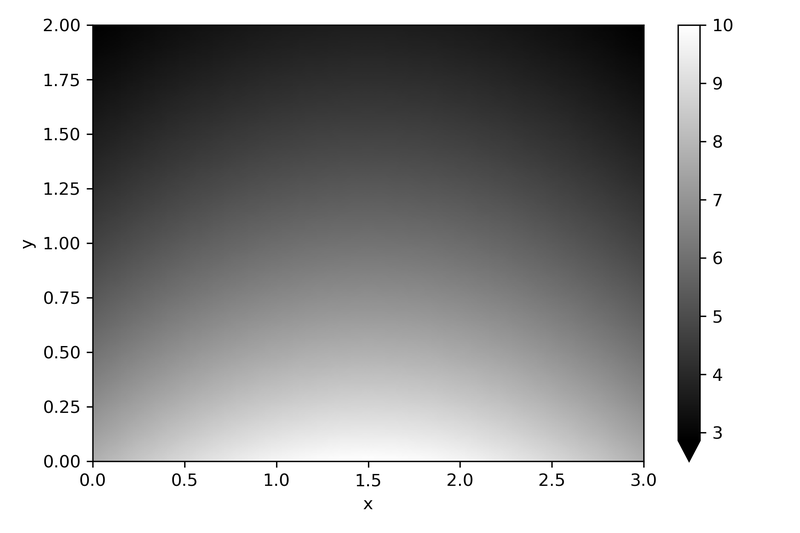
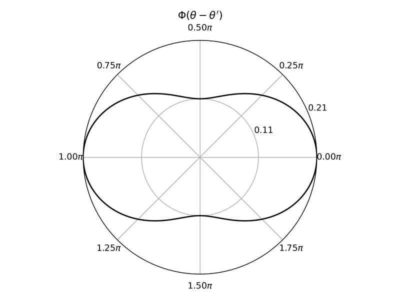
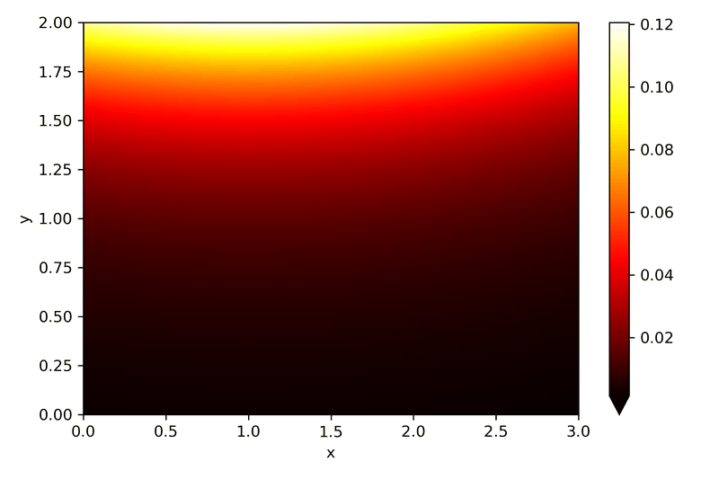
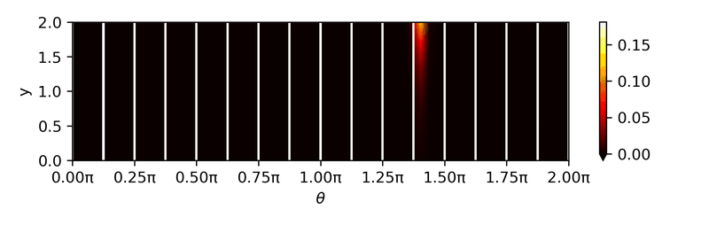
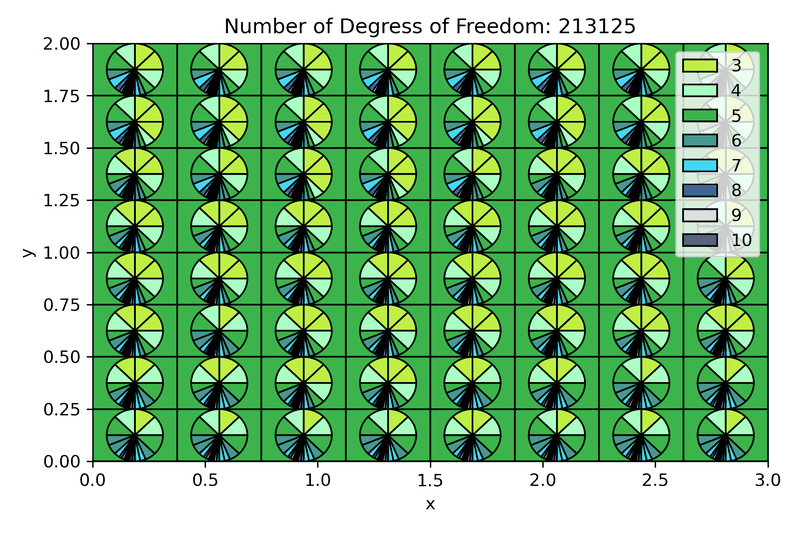
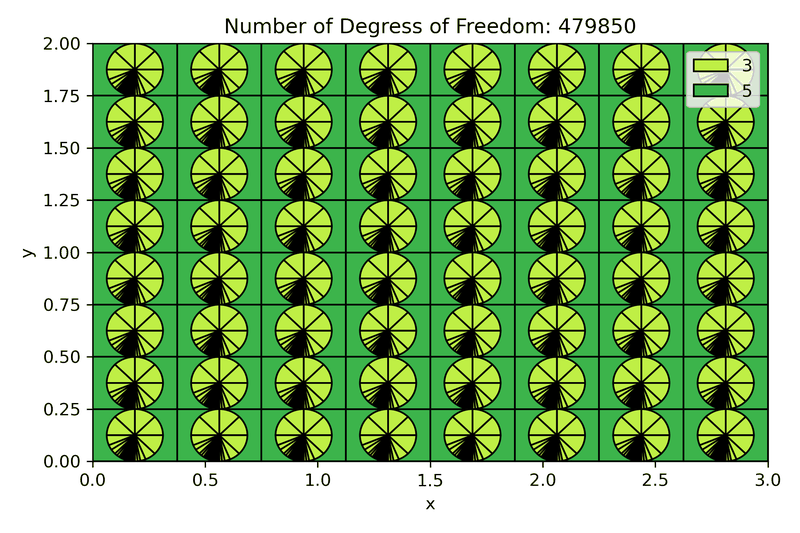
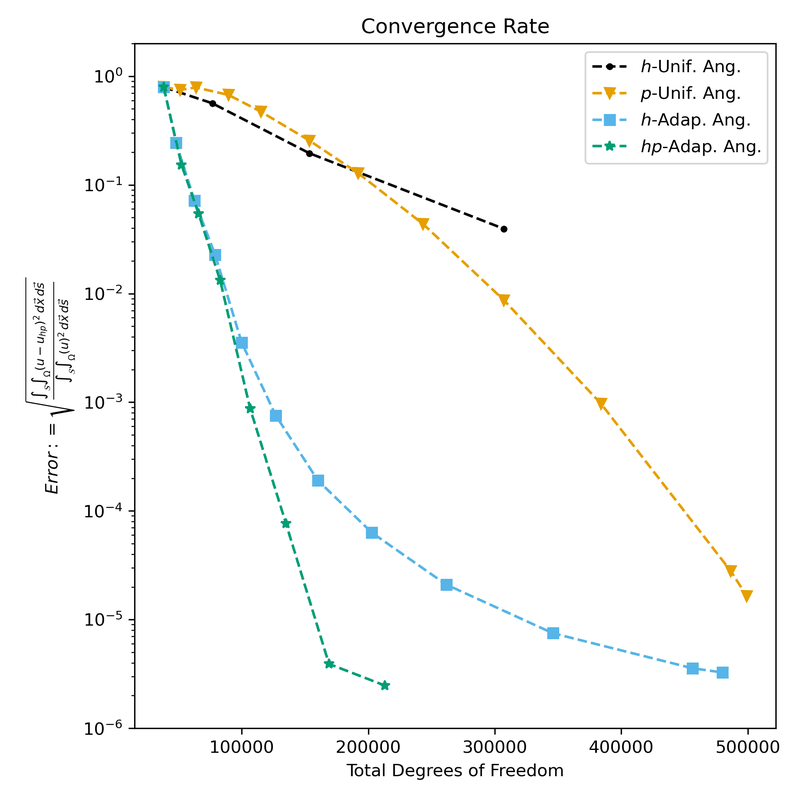

`manufactured-solution`
================================================================================

This subdirectory contains the code and scripts used to generate the 'Manufactured Solution' numerical experiment results (Test Case 1, Section 4.1, Figs. 4-6, and Sections SI-4 and SI-5) reported in

J. L. Torchinsky, S. Du, and S. N. Stechmann, Angular-spatial *hp*-adaptivity for radiative transfer with discontinuous Galerkin spectral element methods, Journal of Quantitative Spectroscopy and Radiative Transfer 348 (2026) 109687, https://doi.org/10.1016/j.jqsrt.2025.109687.

The experiment compares four angular refinement strategies on a problem with a known, separable solution that is narrow in angle and smooth in space. The spatial mesh is never refined. See `../README.md` for the structure shared by all experiments (solve-and-refine loop, MPI roles, stopping conditions, output file formats).

Note: There are difficulties with performing this numerical experiment for the full range of the number of degrees of freedom reported in the results. These difficulties arise from memory requirements for the largest mesh used to calculate the high-resolution error. By disabling this calculation, or using a different machine, this difficulty may be overcome.

The Problem
--------------------------------------------------------------------------------

The code solves Eq. 3,

$\vec{s} \cdot \nabla_{\vec{x}} u + \kappa(\vec{x}) u - \sigma(\vec{x}) \int_0^{2\pi} \Phi(\theta, \theta') u(\vec{x}, \theta') \, d\theta' = f(\vec{x}, \theta)$, with $\vec{s} = (\cos\theta, \sin\theta)$,

on $\Omega = [0, L_x] \times [0, L_y]$ with $L_x = 3$, $L_y = 2$ (`mesh_params["Ls"]`) and $\theta \in [0, 2\pi]$, with inflow Dirichlet boundary conditions (Eq. 4).

- Exact solution (Eq. 22): $u(x, y, \theta) = X(x)\,Y(y)\,\Theta(\theta)$ with $X(x) = e^{-((x - L_x/3)/L_x)^2}$, $Y(y) = e^{-4 (L_y - y)/L_y}$, $\Theta(\theta) = e^{-((96 / (2\pi)) (\theta - 7\pi/5))^2}$. $\Theta$ is a Gaussian of standard deviation $2\pi/(96\sqrt{2}) \approx 0.046$ about $7\pi/5$, i.e., radiation travelling down and to the left.
- Extinction coefficient (code): $\kappa(x, y) = 10\, e^{-((x - L_x/2)/L_x)^2} e^{-y/L_y}$, so $\max \kappa = 10$ at $(L_x/2, 0)$.
- Scattering coefficient (Eq. 20a): $\sigma = 0.1\,\kappa$.
- Scattering phase function: the Rayleigh phase function of Eq. 21, $\Phi(\theta, \theta') = \frac{1}{3\pi}\left(1 + \cos^2(\theta - \theta')\right)$, which integrates to 1 over $[0, 2\pi]$.
- Forcing: $f$ is obtained by substituting $u$, $\kappa$, $\sigma$ and $\Phi$ into Eq. 3. The propagation and extinction terms are evaluated in closed form; the scattering integral $\int_0^{2\pi} \Phi(\theta, \theta') \Theta(\theta') d\theta'$ is computed with `scipy.integrate.quad` at every call.
- Boundary data: $u^{in,bd} = u$ on the whole boundary; `rt` uses it at the inflow nodes only.

**$\kappa$ in the code and in Eq. 20a.** Eq. 20a of the publication gives $\kappa(x, y) = e^{-((x - L_x/2)/L_x)^2} e^{-y/L_y}$, with maximum 1. `problem.py` multiplies this by 10 (`kappa = 10. * kappa_x(x) * kappa_y(y)`), so the code's $\kappa$ (and hence $\sigma = 0.1 \kappa$) is 10 times the value of Eq. 20a. `test-rt/problem.py` contains the same factor. This README records the difference only; it does not say which of the two is intended. (This is the $\kappa$ part of upstream issue #20.)

Initial Mesh, Solver and Refinement Strategies
--------------------------------------------------------------------------------

The initial mesh (`mesh.py`, `mesh_params`) starts from one column and one angular cell with `ndofs = [5, 5, 3]` nodes ($Q_4$ in space, $P_2$ in angle), refines it uniformly `nref_ang = 3` times in angle and `nref_spt = 3` times in space. This gives an $8 \times 8$ grid of columns, each with 8 angular cells: $64 \cdot 25 \cdot 8 \cdot 3 = 38400$ degrees of freedom, as in Section 4.1.

The linear systems are solved with PETSc `gmres` and the `bjacobi` preconditioner (`solver_params`), as stated in Section 4.

| Strategy key | Label in the publication | `ref_kind` | `ref_form` | `ref_tol` [angle, space] |
| --- | --- | --- | --- | --- |
| `h-uni-ang` | *h*-Unif. Ang. | `ang` | `h` | `[0.0, 0.0]` |
| `p-uni-ang` | *p*-Unif. Ang. | `ang` | `p` | `[0.0, 0.0]` |
| `h-amr-ang` | *h*-Adap. Ang. | `ang` | `h` | `[0.8, 0.0]` |
| `hp-amr-ang` | *hp*-Adap. Ang. | `ang` | `hp` | `[0.8, 0.0]` |

In every strategy the angular-jump error indicator (Eq. 14) decides which cells are refined. With `ref_tol[0] = 0.0` every cell is marked, so `h-uni-ang` and `p-uni-ang` are uniform refinements. With `0.8`, a cell is marked when its indicator is at least 0.8 times the largest one (Eq. 15, $\tau_{\vec{s}} = 0.8$). With `ref_form = "hp"`, the angular *hp*-steering criterion (Section 3.4) chooses *h* or *p* for each marked cell.

On output trials the driver also computes

- the analytic error (SI Eq. 8, `Error_Indicator.error_analytic(u)`, root only), $\sqrt{\int\int (u - u_{hp})^2 / \int\int u^2}$. It is the error plotted in `convergence.png` and the error tested against `min_err`;
- the high-resolution error (`Error_Indicator.error_high_resolution`, collective), against a solution on a mesh whose every cell has `ang_ref_offset = 3` more angular nodes and every column `spt_ref_offset = 0` more spatial nodes ("p-refining the mesh of $u_{hp}$ thrice in angle", Section SI-5). It is saved and plotted but not used for refinement or stopping.

Section SI-5 compares adaptive refinement driven by the analytic, high-resolution and angular-jump indicators (Fig. SI-10). The driver in this directory refines only by the angular-jump indicator; the other two are computed for comparison.

Files
--------------------------------------------------------------------------------

### `input.json`

- `ndof_output_ratio` (`1.25`) : a trial is an output trial if its number of degrees of freedom is at least this factor times that of the previous output trial (trial 0 is always one). Only output trials compute the analytic and high-resolution errors and get the full set of plots.
- `solver_params` : keyword arguments for `rt.Problem.solve`, also forwarded to the high-resolution solve.
    - `ksp_type` : The Krylov method name for the `PETSc` KSP object (default `gmres`).
    - `pc_type` : The preconditioner name for the `PETSc` PC object (default `bjacobi`).
    - `rtol`, `atol`, `divtol`, `max_it` (optional) : Tolerances and maximum number of iterations for the `PETSc` KSP object (defaults: `numpy.finfo(float64).resolution` = `1e-15`, `1e-15`, `sqrt` of the largest float, `5000`).
    - `gmres_restart` (optional) : The restart length for (F)GMRES (default: `50`).
    - `PETSc` command-line options (e.g., `-ksp_rtol`, `-ksp_max_it`, `-ksp_monitor`) override these settings. A solve that does not converge (negative `converged_reason`) raises a `RuntimeWarning`.
- `stopping_conditions` : see "Stopping Conditions" in `../README.md`. A value of `0` or less disables the condition.
    - `max_ndof` (`500000`) : Run a trial only if its mesh has at most this many degrees of freedom.
    - `max_ntrial` (`0`, disabled) : Run at most this many trials.
    - `min_err` (`2.5e-6`) : Stop once the analytic error of an output trial is below this value.
- `mesh_params` : Parameters for the initial mesh.
    - `Ls` : Length of the spatial domain in the $x$- and $y$-directions.
    - `pbcs` : Whether the domain is periodic in $x$ and $y$. All experiments use `[false, false]`; periodic domains are not exercised by any experiment.
    - `has_th` : Whether the mesh has an angular dimension (`true`).
    - `ndofs` : Number of nodes per element in the $x$-, $y$-, and $\theta$-directions.
    - `nref_ang` : Number of uniform angular *h*-refinements of the initial single cell ($2^{n}$ cells per column).
    - `nref_spt` : Number of uniform spatial *h*-refinements of the initial single column ($2^{n} \times 2^{n}$ columns).
- `hr_err_params` : Parameters for the high-resolution error (keyword arguments of `Error_Indicator.error_high_resolution`).
    - `ang_ref_offset` : Number of angular nodes added to every cell to obtain the high-resolution mesh.
    - `spt_ref_offset` : Number of nodes added in each spatial direction to every column.
    - Since pull request #30, every element's degree is raised by exactly this offset. Before, the offset was applied as repeated `Mesh.ref_mesh(form = "p")` sweeps, which could raise some elements more than once per sweep.
- `h-uni-ang`, `p-uni-ang`, `h-amr-ang`, `hp-amr-ang` : Keyword arguments of `Error_Indicator` for each refinement strategy.
    - `ref_kind` : Refinement kind (`ang`, `spt`, or `all`).
    - `ref_form` : Refinement form (`h`, `p`, or `hp`).
    - `ref_tol` : Refinement tolerances [angle, space], each between 0 and 1 (inclusive).

### `mesh.py`

Reads `input.json` at import and defines:

- `mesh` (`dg.mesh.Mesh`) : `Mesh(Ls, pbcs, has_th, ndofs)` refined `nref_ang` times with `ref_mesh(kind = "ang", form = "h")`, then `nref_spt` times with `ref_mesh(kind = "spt", form = "h")`. Every rank builds the same mesh.
- `input_dict` (`dict`), `mesh_params` (`dict`) : the parsed input and its `mesh_params` entry.

### `problem.py`

Reads `input.json` at import (for $L_x$, $L_y$) and defines module-level `Lx`, `Ly` (`float`), `sth = 96.` (angular sharpness of $\Theta$), and the functions below. All functions accept NumPy scalars or broadcastable arrays unless noted.

- `X(x)`, `dXdx(x)` : $X(x) = e^{-((x - L_x/3)/L_x)^2}$ and its derivative $-\frac{2}{L_x^2}(x - L_x/3) X(x)$.
- `Y(y)`, `dYdy(y)` : $Y(y) = e^{-4 (L_y - y)/L_y}$ and its derivative $\frac{4}{L_y} Y(y)$.
- `XY(x, y)` : $X(x) Y(y)$.
- `Theta(th)` : $\Theta(\theta) = e^{-((s_{th} / (2\pi)) (\theta - 7\pi/5))^2}$ with $s_{th}$ = `sth`.
- `u(x, y, th)` : exact solution $X(x) Y(y) \Theta(\theta)$ (Eq. 22).
- `kappa_x(x)`, `kappa_y(y)` : $e^{-((x - L_x/2)/L_x)^2}$ and $e^{-y/L_y}$.
- `kappa(x, y)` : $10 \cdot$ `kappa_x(x)` $\cdot$ `kappa_y(y)` (see the note on Eq. 20a above).
- `sigma(x, y)` : $0.1\,\kappa(x, y)$.
- `Phi(th, phi)` : Rayleigh phase function $\frac{1}{3\pi}(1 + \cos^2(\theta - \phi))$ (Eq. 21).
- `f(x, y, th)` : forcing term = propagation $(\cos\theta\, X' Y + \sin\theta\, X Y')\Theta$ + extinction $\kappa u$ - scattering $\sigma X Y \int_0^{2\pi} \Phi(\theta, \phi) \Theta(\phi) d\phi$. `th` must be a scalar (the integral uses `quad`; tolerances `1e-9`, `limit = maxp1 = 100`).
- `bcs(x, y, th)` : boundary data, returns `u(x, y, th)`.
- `dirac` (`[None, None, None]`), `bcs_dirac` (`[bcs, dirac]`) : boundary data in the form expected by `rt.Problem`.
- `u_intg_th(x, y, th0, th1)` : $X(x) Y(y) \int_{\theta_0}^{\theta_1} \Theta\, d\theta$ (scalar `th0`, `th1`; uses `quad`).
- `u_intg_xy(x0, x1, y0, y1, th)` : intended to return $\Theta(\theta) \int_{x_0}^{x_1}\int_{y_0}^{y_1} X Y \, dy\, dx$. It passes `lambda x, y: XY(x, y)` to `scipy.integrate.dblquad`, which calls its integrand as `func(y, x)` with the outer variable ranging over `[x0, x1]`. The result is therefore $\Theta(\theta)\int_{x_0}^{x_1} Y(s)\,ds \int_{y_0}^{y_1} X(t)\,dt$, i.e., with $X$ and $Y$ exchanged. For example, `u_intg_xy(0, 1.5, 0, 0.5, 7*pi/5)` returns `0.0819` while the intended value is `0.0230`. No script calls `u_intg_th` or `u_intg_xy`.
- `problem` (`rt.Problem`) : `Problem(kappa, sigma, Phi, f, bcs_dirac)`.

### `refinement_strategies.py`

Reads `input.json` at import and defines `refinement_strategies` (`dict`): `{"h-uni-ang": ..., "p-uni-ang": ..., "h-amr-ang": ..., "hp-amr-ang": ...}`, each value being the corresponding `input.json` entry (a `dict` with `ref_kind`, `ref_form`, `ref_tol`). The dictionary order is the order in which the strategies are run and plotted.

### `experiment.py`

`main()` runs the solve-and-refine loop of `../README.md` for each strategy, on all ranks (`mpirun -n N python experiment.py --o out`). For each trial:

1. all ranks: `problem.solve(l_mesh, **solver_params)`;
2. root: writes `convergence_info.json`, `matrix_info.json`, `uh.npy` and `mesh.json`; computes `Error_Indicator(uh, **ref_strat).error_angular_jump()` and writes `err_ind_ang_jmp.json`; records `lr_converged_reason` and `lr_res_best` in the log;
3. on output trials: root computes `error_analytic(u)` and writes `err_ind_anl.json`; all ranks compute `error_high_resolution(problem, **solver_params, **hr_err_params)`; root writes `convergence_info_hr.json`, `matrix_info_hr.json`, `uh_hr.npy`, `mesh_hr.json`, `err_ind_hr.json` and records `hr_converged_reason`, `hr_res_best`;
4. root: `l_mesh = err_ind_ang_jmp.ref_by_ind()`, broadcast to all ranks;
5. `min_err` is updated from the most recent analytic error and broadcast; the stopping conditions are checked.

After the last trial, root writes `ref_strat_log.json`. `main()` is run through `utils.run_or_abort`.

### `generate_problem_visualizations.py`

`main()` (one rank) builds a plotting mesh (`ndofs = [5, 5, 5]`, refined 4 times with `ref_mesh(kind = "all", form = "h")`: $16 \times 16$ columns with 16 cells each), projects onto it and writes to `out/`:

- `kappa.png`, `sigma.png` : `plot_xy` of $\kappa/(2\pi)$ and $\sigma/(2\pi)$ (the division undoes the angular integration in `plot_xy`), gray colour map, no mesh lines;
- `Phi.png` : `plot_Phi(Phi, ...)`;
- `u_th.png`, `u_xy.png`, `u_xth.png`, `u_yth.png`, `u_xyth.png` : the projected exact solution, plotted with the five `tools.dg.projection` functions (spatial integral vs. $\theta$, angular integral over $(x, y)$, $y$-integral over $(x, \theta)$, $x$-integral over $(y, \theta)$, and element averages).

Existing files are not overwritten.

`plot_Phi(Phi, file_path)` : polar plot of `Phi(0, th)` for 720 angles in $[0, 2\pi]$, i.e., $\Phi$ as a function of $\theta - \theta'$, with two radial ticks and eight angular ticks; saved at 300 dpi. Returns `None`.

### `generate_error_history.py`

`main()` (run on `N` ranks by `run.sh`). For each strategy without `tracked_vals.json`, it walks the trial directories in numerical order, loads `uh` with `dg.projection.from_file`, and selects the output trials with the same `ndof_output_ratio` rule as `experiment.py`, plus the last trial. For each selected trial, root reads `error` from `err_ind_anl.json`, or computes `error_analytic(u)` and writes `err_ind_anl.json` if it is missing (normally only for the last trial). The value is broadcast, and root writes `tracked_vals.json` = `{ndof: analytic error}`.

### `generate_linear_solve_visualizations.py`

`main()` (one rank): for every trial directory, plots `convergence_info.json` to `convergence_info.png` and `convergence_info_hr.json` to `convergence_info_hr.png`, if the JSON exists and the PNG does not. (Its `argparse` description, "Plots the convergence rates for each refinement strategy", is copied from `generate_convergence_plot.py`.)

`plot_convergence_info(convergence_info, file_path)` : `convergence_info` is a dictionary as written by `experiment.py`. Plots the residual history against iteration $1, \dots,$ `iteration_number + 1` on a log scale, a horizontal line at `atol`, and a vertical line at `max_it` if the solve used all iterations. The title is the converged reason. Returns `None`.

### `generate_experiment_visualizations.py`

`main()` (one rank): for each strategy and each output trial (same selection as `generate_error_history.py`), writes into the trial directory, skipping existing files:

- `mesh.png` (`plot_mesh`), `uh_th.png`, `uh_xy.png`, `uh_xth.png`, `uh_yth.png`, `uh_xyth.png` (the last four with `scale = "pos"`);
- `err_ind_anl.png`, `err_ind_hr.png` : `plot_error_indicator(..., kind = "ang")`, if the JSON exists;
- `err_ind_ang_jmp.png` : `plot_refinement_thresholds(..., kind = "ang")`;
- `mesh_hr.png`, `uh_hr_*.png` : the same plots for the high-resolution solution, if both `mesh_hr.json` and `uh_hr.npy` exist.

### `generate_convergence_plot.py`

`main()` (one rank): reads every strategy's `tracked_vals.json` and plots the analytic error against the total number of degrees of freedom on a log $y$-axis (limits $[10^{-6}, 2]$), one dashed line per strategy with the publication's labels. Writes `out/convergence.png` (overwriting it). Fig. 6 of the publication also shows the error against the number of non-zero entries of the system matrix; no script here produces that plot (the counts are in `matrix_info.json`, key `nz_used`).

### `run.sh`

Runs, from this directory, with `N` = `-n` (default 1) and `OUT_DIR = out`:

1. `mpirun -n 1 python generate_problem_visualizations.py`;
2. `mpirun -n N python experiment.py`;
3. `mpirun -n N python generate_error_history.py`;
4. `mpirun -n 1 python generate_linear_solve_visualizations.py`;
5. `mpirun -n 1 python generate_experiment_visualizations.py`;
6. `mpirun -n 1 python generate_convergence_plot.py`.

Steps 2-6 add the Open MPI option `--use-hwthread-cpus`. `EXPERIMENT_NAME` is only used in `printf` statements. The script stops at the first failed step.

Output Directory
--------------------------------------------------------------------------------

```
out
|--- kappa.png, sigma.png, Phi.png, u_th.png, u_xy.png, u_xth.png, u_yth.png, u_xyth.png
|--- convergence.png
|--- h-uni-ang, p-uni-ang, h-amr-ang, hp-amr-ang
     |--- ref_strat_log.json, tracked_vals.json
     |--- 0, 1, 2, ... : mesh.json, uh.npy, convergence_info.json/.png, matrix_info.json,
                         err_ind_ang_jmp.json/.png, and on output trials err_ind_anl.json/.png,
                         err_ind_hr.json/.png, mesh_hr.json, uh_hr.npy, convergence_info_hr.json/.png,
                         matrix_info_hr.json, mesh.png, uh_*.png, mesh_hr.png, uh_hr_*.png
```

The file formats are described in `../README.md`. Note that `*.npy` files are raw `float64` dumps, not NPY files.

Running the Numerical Experiment
--------------------------------------------------------------------------------

1. Create and activate the included `conda` environment by running the following commands in the root directory:

```
conda env create -f environment.yml
conda activate radiative-transfer-amr
```

2. From this directory, execute the run script using a specified number ($N$) of MPI tasks:

```
bash run.sh -n N
```

(or `chmod +x run.sh` once and then `./run.sh -n N`). The scripts read `input.json` and import `mesh.py`, `problem.py` and `refinement_strategies.py` from the current directory, so they must be run from here. On a cluster, run the script inside an allocation of at least $N$ tasks; scheduler options and the MPI launcher are site-specific.

To modify the experiment, edit `input.json` (mesh, solver, stopping conditions, strategies), `problem.py` (coefficients, solution, boundary data) or `refinement_strategies.py` (which strategies are run).

Results with the current code
--------------------------------------------------------------------------------

The figures below come from a run of the code at commit `f74d84c` (upstream `main` with pull requests #22-#33 merged) with the `input.json` of this directory, executed as `bash run.sh -n 32` (32 MPI ranks on one node; wall time 3.7 h; Python 3.12, NumPy 1.26.4, SciPy 1.13.1, Matplotlib 3.9.2, petsc4py 3.22.0, mpi4py 4.0.0, Open MPI 5.0.5). They were reduced to 800 pixels wide with `python experiments/readme_figures.py 800 <out/...png> figures/<name>.png`. Running `run.sh` writes the full-size versions of these and all other figures to `out/`.

The problem, cf. Fig. 4 of the publication: the extinction coefficient $\kappa/(2\pi)$ (`out/kappa.png`; the colour scale shows the factor 10 discussed above) and the Rayleigh phase function as a function of $\theta - \theta'$ (`out/Phi.png`).





The exact solution, cf. Fig. 5: its angular integral $\int_0^{2\pi} u \, d\theta$ (`out/u_xy.png`) and its integral over $x$ as a function of $(y, \theta)$ (`out/u_yth.png`). As in Fig. 5(b), the white vertical lines are the angular cell edges, where the plotting nodes (Gauss nodes) have no value.





The final meshes of the two adaptive strategies (`out/hp-amr-ang/98/mesh.png`, `out/h-amr-ang/63/mesh.png`), cf. Figs. SI-8 and SI-6. Each wedge is an angular cell, coloured by its number of angular nodes. Both strategies place their small cells around $\theta = 7\pi/5$; *hp*-Adap. Ang. also raises the degree of many cells there.





The analytic error against the total number of degrees of freedom (`out/convergence.png`), cf. the left panel of Fig. 6:



| Strategy | Trials | Final degrees of freedom | Final analytic error | Before the fixes |
| --- | --- | --- | --- | --- |
| *h*-Unif. Ang. | 4 | 307200 | 3.94e-2 | 3.95e-2 |
| *p*-Unif. Ang. | 37 | 499200 | 1.65e-5 | 1.76e-5 |
| *h*-Adap. Ang. | 64 | 479850 | 3.26e-6 | 3.13e-6 (492750) |
| *hp*-Adap. Ang. | 99 | 213125 | 2.47e-6 | 2.48e-6 (213450) |

**Comparison with the publication.** The ranking of Section 4.1.2 is reproduced: *hp*-Adap. Ang. is the most accurate strategy at every mesh size and reaches $3.9 \times 10^{-6}$ with 168975 degrees of freedom, and *h*-Adap. Ang. needs about 480000 degrees of freedom for a similar error. The *hp*-Adap. Ang. run stopped when the error fell below `min_err` $= 2.5 \times 10^{-6}$; the uniform strategies stopped at `max_ndof`. The plot against the number of non-zero matrix entries (right panel of Fig. 6) is not produced by any script.

**Comparison with the code before the fixes.** "Before the fixes" is a run of the same scripts at upstream `main` (commit `8b7cc7f`, with only the module-name fix of pull request #22 applied) on the same machine type and number of ranks (wall time 5.4 h). The error of the initial mesh, shared by all strategies, is 0.793 now and 1.16 before; the two changes that affect it are the analytic-error quadrature (#31, issue #17) and the angular upwind flux (#24, issue #10). The final errors agree to within 7 %. The second *p*-Unif. Ang. point no longer drops far below its neighbours (0.75 now; 0.53 before, between 1.16 and 1.07). All linear solves converged in both runs.
