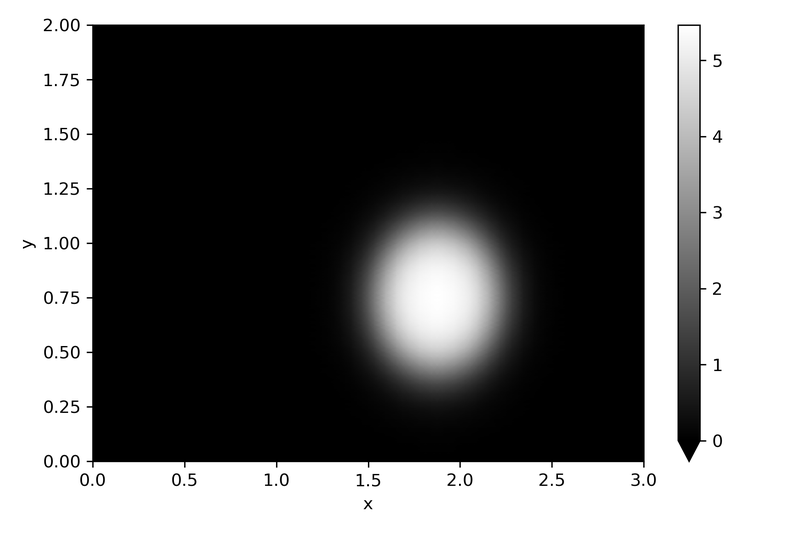
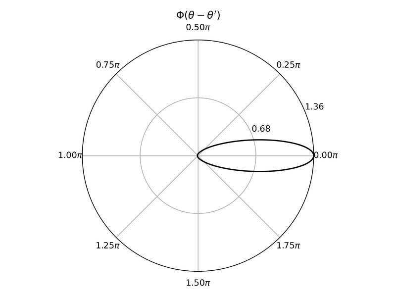
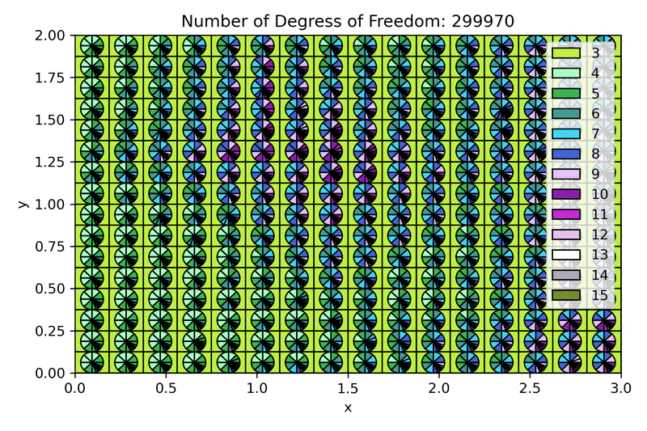
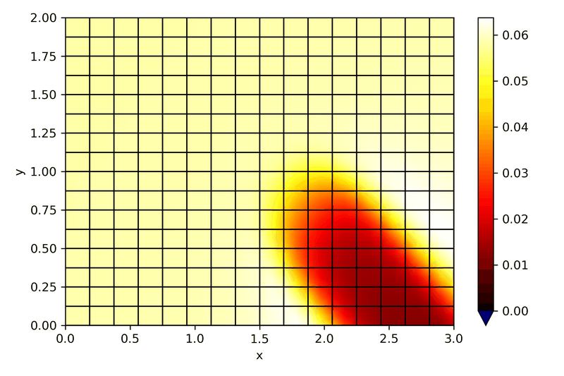
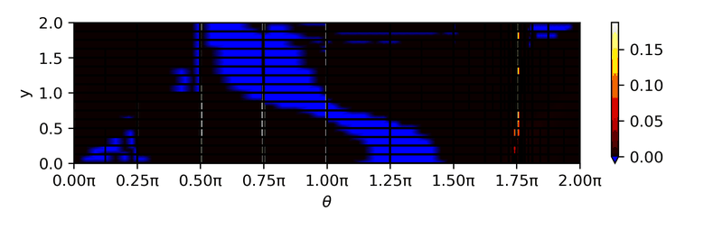
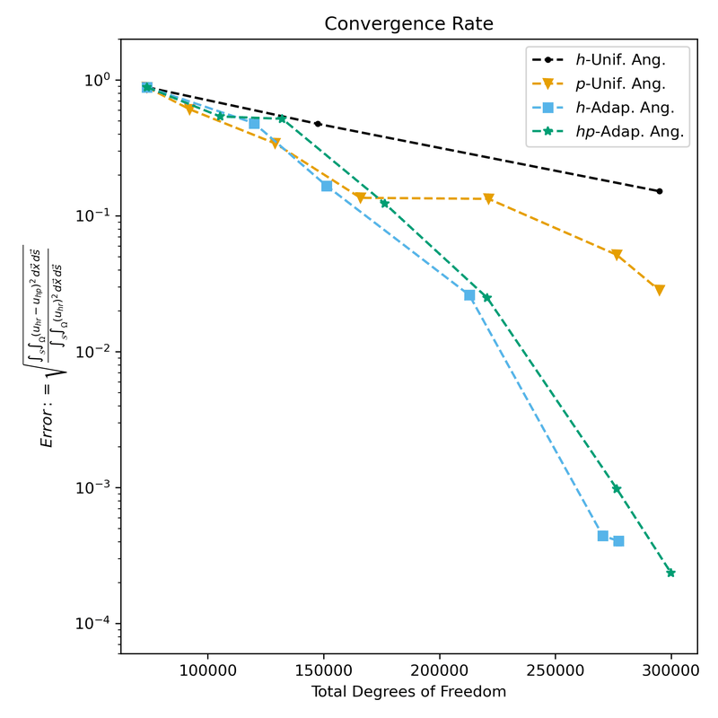

`one-weak-scatterer`
================================================================================

This subdirectory contains the code and scripts used to generate the 'One Weak Scatterer' numerical experiment results (Section SI-7 and Figs. SI-18 to SI-26 of the Supplemental Information) reported in

J. L. Torchinsky, S. Du, and S. N. Stechmann, Angular-spatial *hp*-adaptivity for radiative transfer with discontinuous Galerkin spectral element methods, Journal of Quantitative Spectroscopy and Radiative Transfer 348 (2026) 109687, https://doi.org/10.1016/j.jqsrt.2025.109687.

The experiment compares the same four angular refinement strategies as `../manufactured-solution` on a problem without a known solution: a beam that is sharply peaked in angle enters through the top and left boundaries and passes a single optically-thin circular scatterer. The spatial mesh is never refined. Errors are measured against a high-resolution numerical solution. See `../README.md` for the structure shared by all experiments (solve-and-refine loop, MPI roles, stopping conditions, output file formats).

The Problem
--------------------------------------------------------------------------------

The code solves Eq. 3 on $\Omega = [0, L_x] \times [0, L_y]$ with $L_x = 3$, $L_y = 2$ (`mesh_params["Ls"]`) and $\theta \in [0, 2\pi]$, $\vec{s} = (\cos\theta, \sin\theta)$, with inflow Dirichlet boundary conditions (Eq. 4).

- Extinction coefficient (SI Eqs. 9a-9b): $r(x, y) = L_y/6 - \sqrt{(x - 5L_x/8)^2 + (y - 3L_y/8)^2}$, $\kappa(x, y) = 5.5 / (1 + e^{-15\, r(x, y)})$. This is a smoothed disc of radius $L_y/6$ centred at $(5L_x/8, 3L_y/8) = (1.875, 0.75)$ with $\kappa \approx 5.5$ inside and $\kappa \approx 0$ far outside.
- Scattering coefficient (SI Eq. 9b): $\sigma = 0.7\,\kappa$.
- Scattering phase function: Henyey-Greenstein (Eq. 24) with $g = 0.7$, $\Phi(\theta, \theta') = \frac{1}{C(g)} \frac{1 - g^2}{(1 + g^2 - 2g\cos(\theta - \theta'))^{3/2}}$. The code computes $C(g) = \int_0^{2\pi} \frac{1 - g^2}{(1 + g^2 - 2g\cos\Theta)^{3/2}} d\Theta$ with `scipy.integrate.quad` at import (`Phi_norm`), so that $\Phi$ integrates to 1 over $[0, 2\pi]$ (Eq. 2).
- Forcing: $f = 0$.
- Boundary data (SI Eq. 10): $u^{in,bd}(x, y, \theta) = e^{-((192/(2\pi))(\theta - 7\pi/4))^2}$ if $y = L_y$ or $x = 0$, and $0$ otherwise. The direction $7\pi/4$ points down and to the right, so the beam enters through the top and left edges. The code tests `y == y_top` and `x == x_left` with exact floating-point equality; this holds at the boundary nodes of the meshes used here, because the LGL end nodes are exactly $\pm 1$ and the element edges are dyadic fractions of $L_x$ and $L_y$, so the mapped end nodes equal $0$ and $L_y$ exactly.

Initial Mesh, Solver and Refinement Strategies
--------------------------------------------------------------------------------

The initial mesh (`mesh.py`) has `ndofs = [3, 3, 4]` nodes per element, refined `nref_ang = 3` times in angle and `nref_spt = 4` times in space: a $16 \times 16$ grid of columns with 8 angular cells each, $256 \cdot 9 \cdot 8 \cdot 4 = 73728$ degrees of freedom, as in Section SI-7.

The linear systems are solved with PETSc `fgmres` and the `kaczmarz` preconditioner (`solver_params`), as stated in Section 4.

| Strategy key | Label in the publication | `ref_kind` | `ref_form` | `ref_tol` [angle, space] |
| --- | --- | --- | --- | --- |
| `h-uni-ang` | *h*-Unif. Ang. | `ang` | `h` | `[0.0, 0.0]` |
| `p-uni-ang` | *p*-Unif. Ang. | `ang` | `p` | `[0.0, 0.0]` |
| `h-amr-ang` | *h*-Adap. Ang. | `ang` | `h` | `[0.9, 0.0]` |
| `hp-amr-ang` | *hp*-Adap. Ang. | `ang` | `hp` | `[0.9, 0.0]` |

The angular-jump error indicator (Eq. 14) decides which cells are refined. A tolerance of `0.0` marks every cell (uniform refinement); `0.9` marks cells whose indicator is at least 0.9 times the largest (Eq. 15, $\tau_{\vec{s}} = 0.9$). With `ref_form = "hp"`, the angular *hp*-steering criterion (Section 3.4) chooses *h* or *p* for each marked cell.

On output trials the driver computes the high-resolution error (`Error_Indicator.error_high_resolution`, collective) $\sqrt{\int\int (u_{hr} - u_{hp})^2 / \int\int u_{hr}^2}$, where $u_{hr}$ is solved on a mesh whose every cell has `ang_ref_offset = 3` more angular nodes and every column `spt_ref_offset = 0` more spatial nodes ("p-refining the low-resolution hp-mesh thrice in angle", Section SI-7.2). This error is tested against `min_err` and plotted in `convergence.png`.

Files
--------------------------------------------------------------------------------

### `input.json`

- `ndof_output_ratio` (`1.25`) : a trial is an output trial if its number of degrees of freedom is at least this factor times that of the previous output trial (trial 0 is always one). Only output trials compute the high-resolution error and get the full set of plots.
- `solver_params` : keyword arguments for `rt.Problem.solve`, also forwarded to the high-resolution solve.
    - `ksp_type` : The Krylov method name for the `PETSc` KSP object (default `gmres`).
    - `pc_type` : The preconditioner name for the `PETSc` PC object (default `bjacobi`).
    - `rtol`, `atol`, `divtol`, `max_it` (optional) : Tolerances and maximum number of iterations for the `PETSc` KSP object (defaults: `numpy.finfo(float64).resolution` = `1e-15`, `1e-15`, `sqrt` of the largest float, `5000`).
    - `gmres_restart` (optional) : The restart length for (F)GMRES (default: `50`).
    - `PETSc` command-line options (e.g., `-ksp_rtol`, `-ksp_max_it`, `-ksp_monitor`) override these settings. A solve that does not converge (negative `converged_reason`) raises a `RuntimeWarning`.
- `stopping_conditions` : see "Stopping Conditions" in `../README.md`. A value of `0` or less disables the condition.
    - `max_ndof` (`300000`) : Run a trial only if its mesh has at most this many degrees of freedom.
    - `max_ntrial` (`0`, disabled) : Run at most this many trials.
    - `min_err` (`1.0e-4`) : Stop once the high-resolution error of an output trial is below this value.
- `mesh_params` : Parameters for the initial mesh.
    - `Ls` : Length of the spatial domain in the $x$- and $y$-directions.
    - `pbcs` : Whether the domain is periodic in $x$ and $y$. All experiments use `[false, false]`; periodic domains are not exercised by any experiment.
    - `has_th` : Whether the mesh has an angular dimension (`true`).
    - `ndofs` : Number of nodes per element in the $x$-, $y$-, and $\theta$-directions.
    - `nref_ang` : Number of uniform angular *h*-refinements of the initial single cell ($2^{n}$ cells per column).
    - `nref_spt` : Number of uniform spatial *h*-refinements of the initial single column ($2^{n} \times 2^{n}$ columns).
- `hr_err_params` : Parameters for the high-resolution error (keyword arguments of `Error_Indicator.error_high_resolution`).
    - `ang_ref_offset` : Number of angular nodes added to every cell to obtain the high-resolution mesh.
    - `spt_ref_offset` : Number of nodes added in each spatial direction to every column.
    - Since pull request #30, every element's degree is raised by exactly this offset. Before, the offset was applied as repeated `Mesh.ref_mesh(form = "p")` sweeps, which could raise some elements more than once per sweep.
- `h-uni-ang`, `p-uni-ang`, `h-amr-ang`, `hp-amr-ang` : Keyword arguments of `Error_Indicator` for each refinement strategy.
    - `ref_kind` : Refinement kind (`ang`, `spt`, or `all`).
    - `ref_form` : Refinement form (`h`, `p`, or `hp`).
    - `ref_tol` : Refinement tolerances [angle, space], each between 0 and 1 (inclusive).

### `mesh.py`

Identical to `../manufactured-solution/mesh.py`. Reads `input.json` at import and defines `mesh` (`dg.mesh.Mesh`): `Mesh(Ls, pbcs, has_th, ndofs)` refined `nref_ang` times with `ref_mesh(kind = "ang", form = "h")`, then `nref_spt` times with `ref_mesh(kind = "spt", form = "h")`. Also defines `input_dict` and `mesh_params` (`dict`).

### `problem.py`

Reads `input.json` at import (for $L_x$, $L_y$) and defines:

- `r(x, y)` : signed distance-like function $L_y/6 - \sqrt{(x - 5L_x/8)^2 + (y - 3L_y/8)^2}$ (positive inside the scatterer). Accepts broadcastable arrays.
- `kappa(x, y)` : $5.5 / (1 + e^{-15\, r(x, y)})$ (SI Eq. 9b).
- `sigma(x, y)` : $0.7\,\kappa(x, y)$.
- `g` (`float`, `0.7`) : Henyey-Greenstein asymmetry parameter.
- `Phi_HG(Th)` : unnormalized Henyey-Greenstein kernel $(1 - g^2)/(1 + g^2 - 2g\cos\Theta)^{3/2}$ of the angle difference `Th`.
- `Phi_norm`, `abserr` (`float`) : $\int_0^{2\pi}$ `Phi_HG` and the `quad` error estimate (tolerances `1e-9`).
- `Phi(th, phi)` : normalized phase function `((1 - g**2) / Phi_norm) / (1 + g**2 - 2 g cos(th - phi))**1.5` (Eq. 24 with $C(g)$ = `Phi_norm`).
- `f(x, y, th)` : returns `0.` (a Python scalar for any input).
- `x_left` (`0.`), `y_top` (`Ly`) : edges with incoming radiation.
- `bcs(x, y, th)` : boundary data of SI Eq. 10 with angular sharpness `sth = 96. * 2.` (= 192). `x` and `y` must be scalars, since the test `(y == y_top) or (x == x_left)` is a Python `or`.
- `dirac` (`[None, None, None]`), `bcs_dirac` (`[bcs, dirac]`) : boundary data in the form expected by `rt.Problem`.
- `problem` (`rt.Problem`) : `Problem(kappa, sigma, Phi, f, bcs_dirac)`.

There is no exact solution `u`.

### `refinement_strategies.py`

Identical to `../manufactured-solution/refinement_strategies.py`: defines `refinement_strategies` (`dict`) with the keys `h-uni-ang`, `p-uni-ang`, `h-amr-ang`, `hp-amr-ang`, each mapped to the corresponding `input.json` entry. The dictionary order is the order in which the strategies are run and plotted.

### `experiment.py`

`main()` runs the solve-and-refine loop of `../README.md` for each strategy on all ranks. It is the Manufactured Solution driver without the analytic error. For each trial:

1. all ranks: `problem.solve(l_mesh, **solver_params)`;
2. root: writes `convergence_info.json`, `matrix_info.json`, `uh.npy`, `mesh.json`; computes `error_angular_jump()` with the strategy's parameters and writes `err_ind_ang_jmp.json`; logs `lr_converged_reason`, `lr_res_best`;
3. on output trials: all ranks compute `error_high_resolution(problem, **solver_params, **hr_err_params)`; root writes `convergence_info_hr.json`, `matrix_info_hr.json`, `uh_hr.npy`, `mesh_hr.json`, `err_ind_hr.json` and logs `hr_converged_reason`, `hr_res_best`;
4. root: `l_mesh = err_ind_ang_jmp.ref_by_ind()`, broadcast to all ranks;
5. `min_err` is updated from the most recent high-resolution error and broadcast; the stopping conditions are checked.

After the last trial, root writes `ref_strat_log.json`. `main()` is run through `utils.run_or_abort`.

### `generate_problem_visualizations.py`

`main()` (one rank) projects onto a plotting mesh (`ndofs = [5, 5, 5]`, refined 4 times with `ref_mesh(kind = "all", form = "h")`) and writes to `out/`, skipping existing files:

- `kappa.png`, `sigma.png` : `plot_xy` of $\kappa/(2\pi)$ and $\sigma/(2\pi)$ (the division undoes the angular integration in `plot_xy`); these correspond to Fig. SI-18(a);
- `Phi.png` : `plot_Phi(Phi, ...)`, Fig. SI-18(b).

`plot_Phi(Phi, file_path)` : polar plot of `Phi(0, th)` for 720 angles in $[0, 2\pi]$, i.e., $\Phi$ as a function of $\theta - \theta'$; saved at 300 dpi. Returns `None`.

### `generate_error_history.py`

`main()` (run on `N` ranks by `run.sh`). For each strategy without `tracked_vals.json`, walks the trial directories in numerical order, loads `uh`, and selects the output trials with the `ndof_output_ratio` rule of `experiment.py`, plus the last trial. For each selected trial it reads `error` from `err_ind_hr.json`. If that file is missing (normally only for the last trial), all ranks compute `error_high_resolution(problem, **solver_params, **hr_err_params)`, and root writes `uh_hr.npy` and `mesh_hr.json` (unless both exist), `err_ind_hr.json`, `convergence_info_hr.json` and `matrix_info_hr.json`. Root then writes `tracked_vals.json` = `{ndof: high-resolution error}`.

### `generate_linear_solve_visualizations.py`

Identical to the Manufactured Solution script. `main()` plots `convergence_info.json` to `convergence_info.png` and `convergence_info_hr.json` to `convergence_info_hr.png` in every trial directory. `plot_convergence_info(convergence_info, file_path)` plots the residual history (log scale) with a line at `atol` and, if all iterations were used, at `max_it`; returns `None`.

### `generate_experiment_visualizations.py`

`main()` (one rank): for each output trial (and the last trial), writes `mesh.png`, `uh_th.png`, `uh_xy.png`, `uh_xth.png`, `uh_yth.png`, `uh_xyth.png`; `err_ind_hr.png` (`plot_error_indicator(..., kind = "ang")`); `err_ind_ang_jmp.png` (`plot_refinement_thresholds(..., kind = "ang")`); and, if `mesh_hr.json` and `uh_hr.npy` exist, `mesh_hr.png` and `uh_hr_*.png`. Existing files are skipped. The final meshes and solutions correspond to Figs. SI-20 to SI-25.

### `generate_convergence_plot.py`

`main()` (one rank): plots every strategy's `tracked_vals.json` (high-resolution error against total degrees of freedom, log $y$-axis with limits $[6 \times 10^{-5}, 2]$) to `out/convergence.png`, cf. Fig. SI-26. The plot against the number of non-zero matrix entries is not produced by any script.

### `run.sh`

Runs, from this directory, with `N` = `-n` (default 1) and `OUT_DIR = out`: `generate_problem_visualizations.py` (1 rank), `experiment.py` (`N` ranks), `generate_error_history.py` (`N` ranks), `generate_linear_solve_visualizations.py`, `generate_experiment_visualizations.py`, `generate_convergence_plot.py` (1 rank each). Every step uses `mpirun --use-hwthread-cpus`. `EXPERIMENT_NAME` is only used in `printf` statements. The script stops at the first failed step.

Output Directory
--------------------------------------------------------------------------------

```
out
|--- kappa.png, sigma.png, Phi.png
|--- convergence.png
|--- h-uni-ang, p-uni-ang, h-amr-ang, hp-amr-ang
     |--- ref_strat_log.json, tracked_vals.json
     |--- 0, 1, 2, ... : mesh.json, uh.npy, convergence_info.json/.png, matrix_info.json,
                         err_ind_ang_jmp.json/.png, and on output trials err_ind_hr.json/.png,
                         mesh_hr.json, uh_hr.npy, convergence_info_hr.json/.png,
                         matrix_info_hr.json, mesh.png, uh_*.png, mesh_hr.png, uh_hr_*.png
```

The file formats are described in `../README.md`. Note that `*.npy` files are raw `float64` dumps, not NPY files.

Running the Numerical Experiment
--------------------------------------------------------------------------------

1. Create and activate the included `conda` environment by running the following commands in the root directory:

```
conda env create -f environment.yml
conda activate radiative-transfer-amr
```

2. From this directory, execute the run script using a specified number ($N$) of MPI tasks:

```
bash run.sh -n N
```

(or `chmod +x run.sh` once and then `./run.sh -n N`). The scripts read `input.json` and import `mesh.py`, `problem.py` and `refinement_strategies.py` from the current directory, so they must be run from here. On a cluster, run the script inside an allocation of at least $N$ tasks; scheduler options and the MPI launcher are site-specific.

To modify the experiment, edit `input.json` (mesh, solver, stopping conditions, strategies), `problem.py` (coefficients, boundary data) or `refinement_strategies.py` (which strategies are run).

Results with the current code
--------------------------------------------------------------------------------

The figures below come from a run of the code at commit `f74d84c` (upstream `main` with pull requests #22-#33 merged) with the `input.json` of this directory, executed as `bash run.sh -n 24` (24 MPI ranks on one node; wall time 5.9 h; Python 3.12, NumPy 1.26.4, SciPy 1.13.1, Matplotlib 3.9.2, petsc4py 3.22.0, mpi4py 4.0.0, Open MPI 5.0.5). They were reduced to 800 pixels wide with `python experiments/readme_figures.py 800 <out/...png> figures/<name>.png`. Running `run.sh` writes the full-size versions of these and all other figures to `out/`.

The problem, cf. Fig. SI-18: the extinction coefficient $\kappa/(2\pi)$ (`out/kappa.png`) and the Henyey-Greenstein phase function with $g = 0.7$ as a function of $\theta - \theta'$ (`out/Phi.png`).





The final mesh of *hp*-Adap. Ang. (`out/hp-amr-ang/188/mesh.png`, 299970 degrees of freedom), cf. Fig. SI-24(a). Each wedge is an angular cell, coloured by its number of angular nodes; the small, high-degree cells lie around the beam direction $7\pi/4$.



The final numerical solution of *hp*-Adap. Ang., cf. Fig. SI-25: the angular integral $\int_0^{2\pi} u_{hp} \, d\theta$ (`out/hp-amr-ang/188/uh_xy.png`) and the integral over $x$ as a function of $(y, \theta)$ (`out/hp-amr-ang/188/uh_yth.png`). The scatterer casts a shadow towards the lower right.





The high-resolution error against the total number of degrees of freedom (`out/convergence.png`), cf. the left panel of Fig. SI-26:



| Strategy | Trials | Final degrees of freedom | Final high-resolution error | Before the fixes |
| --- | --- | --- | --- | --- |
| *h*-Unif. Ang. | 3 | 294912 | 1.52e-1 | 1.52e-1 |
| *p*-Unif. Ang. | 13 | 294912 | 2.83e-2 | 2.83e-2 |
| *h*-Adap. Ang. | 83 | 277272 | 4.05e-4 | 4.03e-4 (280188, 91 trials) |
| *hp*-Adap. Ang. | 189 | 299970 | 2.35e-4 | 6.35e-5 (299907, 299 trials) |

All four strategies stopped at `max_ndof` $= 300000$; none reached `min_err` $= 10^{-4}$. All linear solves converged.

**Comparison with the publication.** Section SI-7.2 and Fig. SI-26 report that *hp*-Adap. Ang. performs best for mid- to large meshes and is about ten times more accurate than *h*-Adap. Ang. at about 250000 degrees of freedom. This run does not reproduce that. The two adaptive strategies have similar errors up to about 220000 degrees of freedom (0.026 at 212000 for *h*-Adap. Ang., 0.025 at 220000 for *hp*-Adap. Ang.). Near 275000 *h*-Adap. Ang. is ahead (4.4e-4 at 270000 against 9.8e-4 at 276000), and *hp*-Adap. Ang. is ahead only at its last point (2.35e-4 at 299970). The ordering of the other strategies (*h*-Unif. Ang. worst, then *p*-Unif. Ang.) agrees with the publication.

**Comparison with the code before the fixes.** "Before the fixes" is a run of the same scripts at upstream `main` (commit `8b7cc7f`, with only the module-name fix of pull request #22 applied) on the same machine type and number of ranks (wall time 8.3 h). That run does reproduce the publication's ranking: its *hp*-Adap. Ang. error is 0.014 at 192000 and 4.4e-4 at 243000 degrees of freedom. The uniform strategies give the same errors to three digits, and *h*-Adap. Ang. differs by less than 20 % at every point. So the change concerns *hp*-Adap. Ang. only. Four of the merged fixes can affect this strategy:

- the *hp*-steering formulas (#23, issues #7-#9), which decide between *h*- and *p*-refinement of a marked cell;
- the angular upwind flux (#24, issue #10);
- the high-resolution reference mesh (#30, issue #16), which now raises every element's degree by exactly `ang_ref_offset`;
- the Krylov settings (#28, issue #14). Two linear solves of the earlier *hp*-Adap. Ang. run (trials 177 and 293) ended with a negative converged reason, which that code did not report.

The fixed strategy also needs fewer trials (189 against 299) to reach the same mesh size, so it takes larger refinement steps. Which of these changes causes the difference has not been isolated; a rerun of this strategy with each fix applied on its own would settle it.
