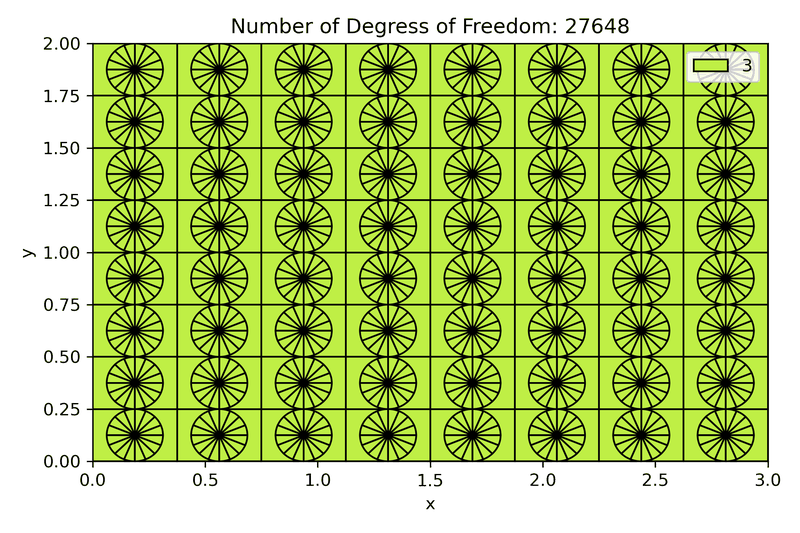
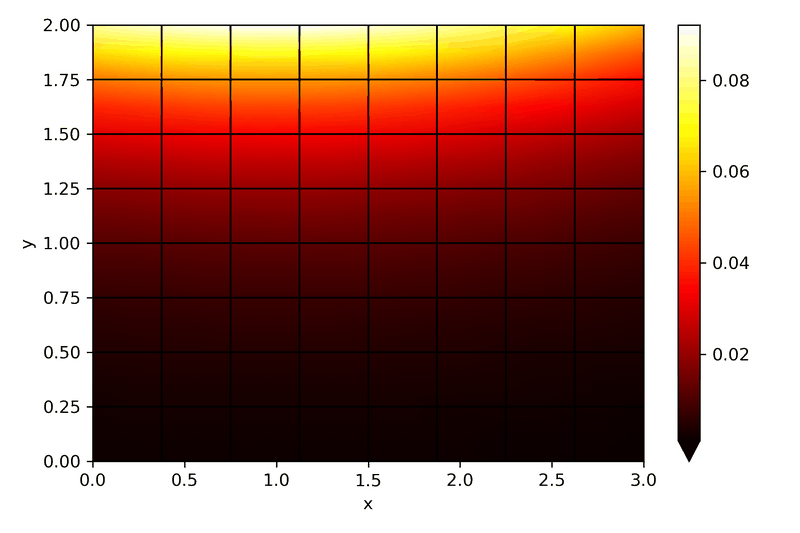
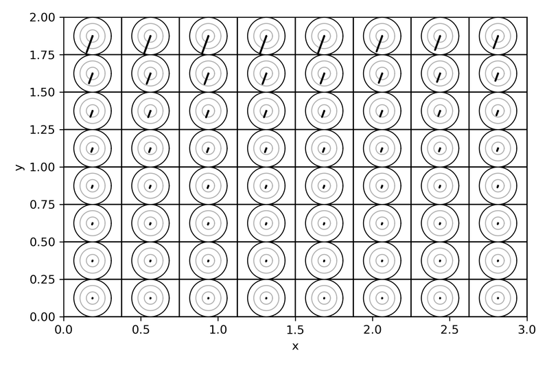
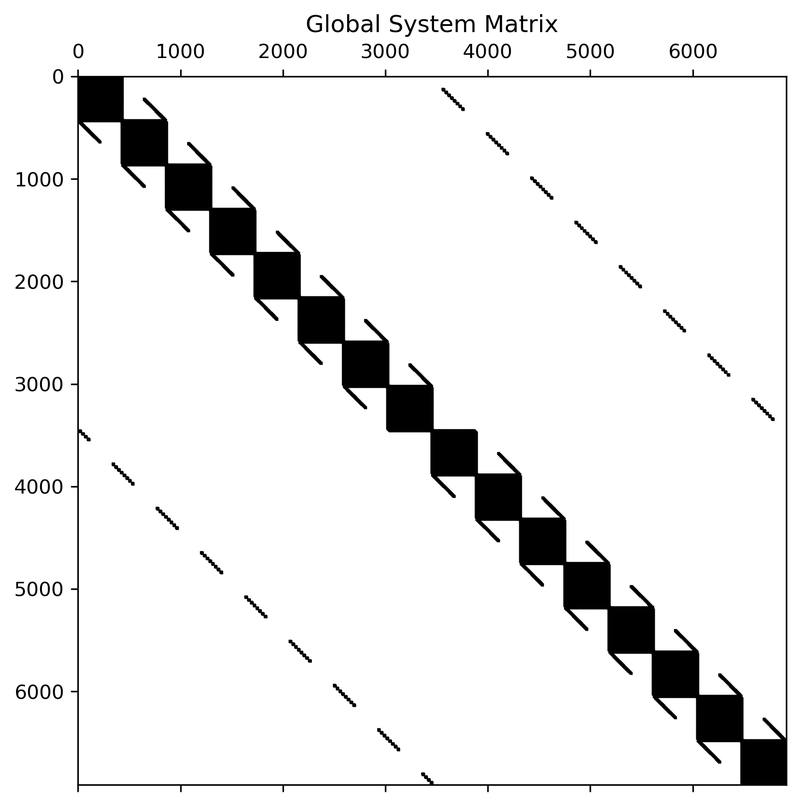
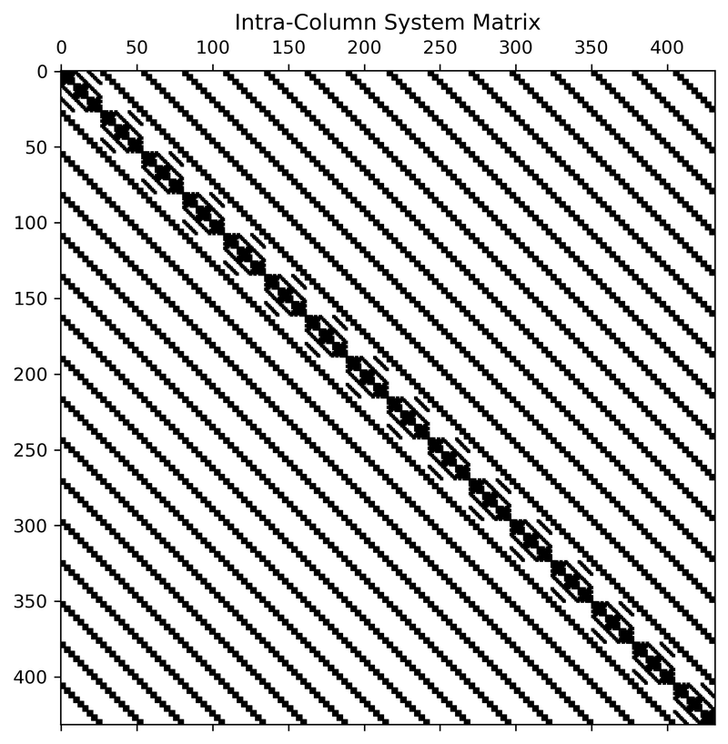

`test-rt`
================================================================================

This subdirectory contains the code and scripts used to test source code in the `src/rt` subdirectory. We have included it in the `experiments` subdirectory as it requires MPI.

The user may think of this test as a simplified version of the numerical experiments in the `manufactured-solution`, `one-weak-scatterer`, and `two-strong-scatterers` subdirectories. As such, we refer to this test in the code as an 'experiment'.

The test assembles each DG matrix of `rt.Problem` on a fixed mesh, plots its sparsity pattern, solves the problem once, and plots the solution. It does not refine the mesh and does not compare the solution with the exact solution: it checks only that assembly and the distributed solve run to completion, and leaves the figures for visual inspection. The unit tests that run under `pytest` are in `tests/` at the repository root.

How It Fits Into the Whole
--------------------------------------------------------------------------------

`experiment.py` uses `rt.Problem` (`mass_matrix`, `scattering_matrix`, `interior_convection_matrix`, `boundary_convection_matrix`, `solve`), `dg.mesh.Mesh` and the plotting functions `tools.dg.mesh.plot_mesh`, `tools.dg.projection.plot_th`/`plot_xth`/`plot_yth`/`plot_xy`/`plot_xyth` and `tools.rt.plot_matrix`. See `../README.md` for the conventions shared by all experiments.

The Problem
--------------------------------------------------------------------------------

`problem.py` is the Manufactured Solution problem of `../manufactured-solution/problem.py` (Eqs. 20a-22) with the same functions and values: $L_x = 3$, $L_y = 2$, exact solution $u = X(x) Y(y) \Theta(\theta)$ with $X(x) = e^{-((x - L_x/3)/L_x)^2}$, $Y(y) = e^{-4 (L_y - y)/L_y}$, $\Theta(\theta) = e^{-((96 / (2\pi)) (\theta - 7\pi/5))^2}$; $\kappa(x, y) = 10\, e^{-((x - L_x/2)/L_x)^2} e^{-y/L_y}$; $\sigma = 0.1\,\kappa$; Rayleigh $\Phi(\theta, \theta') = \frac{1}{3\pi}(1 + \cos^2(\theta - \theta'))$; $f$ from substituting $u$ into Eq. 3; boundary data $u$.

As in `manufactured-solution`, the code's $\kappa$ is 10 times the $\kappa$ of Eq. 20a of the publication (see `../manufactured-solution/README.md`).

The mesh (`mesh.py`, `input.json`) has `ndofs = [3, 3, 3]` nodes per element, refined `nref_ang = 4` times in angle and `nref_spt = 3` times in space: an $8 \times 8$ grid of columns with 16 angular cells each, $64 \cdot 9 \cdot 16 \cdot 3 = 27648$ degrees of freedom. The solve uses the defaults of `rt.Problem.solve` (`gmres`, `bjacobi`, `rtol = atol = 1e-15`, `max_it = 5000`, `gmres_restart = 50`).

Files
--------------------------------------------------------------------------------

### `input.json`

- `mesh_params` : Parameters for the mesh.
    - `Ls` : Length of the spatial domain in the $x$- and $y$-directions.
    - `pbcs` : Whether the domain is periodic in $x$ and $y$ (`[false, false]`).
    - `has_th` : Whether the mesh has an angular dimension (`true`).
    - `ndofs` : Number of nodes per element in the $x$-, $y$-, and $\theta$-directions.
    - `nref_ang` : Number of uniform angular *h*-refinements of the initial single cell ($2^{n}$ cells per column).
    - `nref_spt` : Number of uniform spatial *h*-refinements of the initial single column ($2^{n} \times 2^{n}$ columns).
    - `ang_res_offset`, `spt_res_offset` : Not read by any script in this directory.

### `mesh.py`

Identical to `../manufactured-solution/mesh.py`. Reads `input.json` at import and defines `mesh` (`dg.mesh.Mesh`): `Mesh(Ls, pbcs, has_th, ndofs)` refined `nref_ang` times with `ref_mesh(kind = "ang", form = "h")`, then `nref_spt` times with `ref_mesh(kind = "spt", form = "h")`. Also defines `input_dict` and `mesh_params` (`dict`).

### `problem.py`

The same definitions as `../manufactured-solution/problem.py` (only comments differ): `Lx`, `Ly`, `sth`, `X`, `dXdx`, `Y`, `dYdy`, `XY`, `Theta`, `u`, `kappa_x`, `kappa_y`, `kappa`, `sigma`, `Phi`, `f`, `bcs`, `dirac`, `bcs_dirac`, `u_intg_th`, `u_intg_xy` and `problem` (`rt.Problem(kappa, sigma, Phi, f, bcs_dirac)`), with the same arguments (`x`, `y`, `th`, `phi`, `th0`, `th1`, `x0`, `x1`, `y0`, `y1`) and return values. See that README for each function. As there, `u_intg_xy` exchanges the roles of $X$ and $Y$ (the integrand passed to `scipy.integrate.dblquad` is called as `func(y, x)`); no script calls it.

### `experiment.py`

`main()` runs on all ranks (`mpirun -n N python experiment.py --o out`). The output directory is `--o` (default `figs`, so that without `--o` the figures go to `figs/figs/`); `run.sh` passes `out`.

1. Root creates `OUT_DIR/figs/`, writes the mesh to `OUT_DIR/mesh.json` (`Mesh.to_file`) and plots it to `figs/mesh.png`.
2. For each of `problem.mass_matrix(mesh)` (the extinction term $\int \kappa\, u\, v$), `problem.scattering_matrix(mesh)`, `problem.interior_convection_matrix(mesh)`, `problem.boundary_convection_matrix(mesh)` and the system matrix `mass - scattering + (boundary_convection - interior_convection)`: all ranks assemble the distributed `PETSc.Mat` (collective). Root then extracts three dense blocks and plots each with `plot_matrix`:
    - `figs/<name>_global.png` : the rows and columns owned by rank 0 (`mat[r0:r1, r0:r1]`, `(r0, r1) = mat.getOwnershipRange()`);
    - `figs/<name>_column.png` : the leading block of size `nx * ny * (sum of nth over the cells)` of the column with the smallest key;
    - `figs/<name>_cell.png` : the leading block of size `nx * ny * nth` of that column's cell with the smallest key,

   with `<name>` one of `mass`, `scattering`, `interior_convection`, `boundary_convection`, `system`. These blocks are the first column and cell because the global DOF order is by column key, then cell key. The system matrix plotted here includes the inflow-boundary DOFs, which `Problem.solve` removes before the Krylov solve.
3. All ranks call `problem.solve(mesh)` with the default solver settings. Root writes the solution to `OUT_DIR/uh.npy` (raw `float64`, without the mesh; the mesh is the one in `OUT_DIR/mesh.json`) and plots it to `figs/uh_th.png`, `figs/uh_xth.png`, `figs/uh_yth.png`, `figs/uh_xy.png` and `figs/uh_xyth.png` (colour map `hot`, scale `normal`).

`main()` is run through `utils.run_or_abort`, so an exception on any rank aborts the job with a non-zero exit status.

### `run.sh`

Runs `mpirun -n N python experiment.py --o out`, with `N` = `-n` (default 1). `EXPERIMENT_NAME` is only used in `printf` statements. The script stops at the first failed step. (Before pull request #32 it also called `plot_kappa_sigma_phi.py` and `plot_u.py`, which are not in the repository, and the directory contained an unused `params.py`; both were removed.)

Output Directory
--------------------------------------------------------------------------------

```
out
|--- mesh.json, uh.npy
|--- figs
     |--- mesh.png
     |--- mass_global.png, mass_column.png, mass_cell.png
     |--- scattering_*.png, interior_convection_*.png, boundary_convection_*.png, system_*.png
     |--- uh_th.png, uh_xth.png, uh_yth.png, uh_xy.png, uh_xyth.png
```

To read the solution back: `dg.projection.from_file("out/mesh.json", "out/uh.npy")`.

Running the Test
--------------------------------------------------------------------------------

1. Create and activate the included `conda` environment by running the following commands in the root directory:

```
conda env create -f environment.yml
conda activate radiative-transfer-amr
```

2. From this directory, execute the run script using a specified number ($N$) of MPI tasks:

```
bash run.sh -n N
```

(or `chmod +x run.sh` once and then `./run.sh -n N`). The scripts read `input.json` and import `mesh.py` and `problem.py` from the current directory, so they must be run from here. On a cluster, run the script inside an allocation of at least $N$ tasks; scheduler options and the MPI launcher are site-specific.

To modify the test, edit `input.json` (mesh) or `problem.py` (coefficients, solution, boundary data).

Results with the current code
--------------------------------------------------------------------------------

The figures below come from a run of the code at commit `f74d84c` (upstream `main` with pull requests #22-#33 merged) with the `input.json` of this directory, executed as `bash run.sh -n 4` (4 MPI ranks; wall time 76 s; Python 3.12, NumPy 1.26.4, SciPy 1.13.1, petsc4py 3.22.0, mpi4py 4.0.0, Open MPI 5.0.5). They were reduced to 800 pixels wide with `python experiments/readme_figures.py 800 out/figs/<name>.png figures/<name>.png`. Running `run.sh` writes the full-size versions of these and the other figures to `out/figs/`.

The mesh: an $8 \times 8$ grid of columns, each with 16 angular cells and $3 \times 3 \times 3$ nodes per element (27648 degrees of freedom).



The angular integral of the numerical solution, $\int_0^{2\pi} u_h \, d\theta$ (`uh_xy.png`), and, in each column, the spatial integral of $u_h$ over the column as a function of $\theta$, drawn as a polar curve (`uh_th.png`; all columns share one radial scale whose centre is the smallest value, see `src/tools/dg/projection/README.md`). The solution is the Manufactured Solution of `../manufactured-solution`: it is largest at the top boundary $y = L_y$ and concentrated around the direction $\theta = 7\pi/5$.





Sparsity of the system matrix (mass + boundary convection - interior convection - scattering) restricted to the rows and columns owned by rank 0 (`system_global.png`, 16 of the 64 columns), and its block for the column with the smallest key (`system_column.png`). Each dense diagonal block couples the 432 degrees of freedom of one column through scattering; the off-diagonal bands are the upwind couplings to neighbouring columns.




